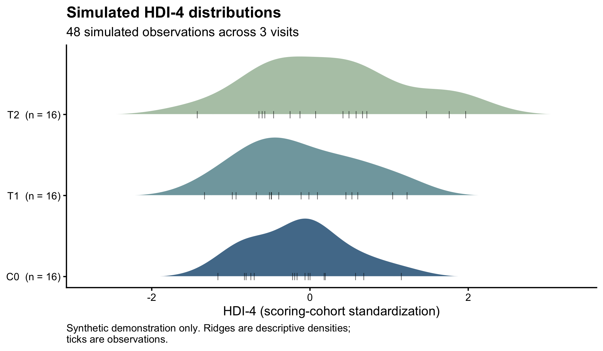
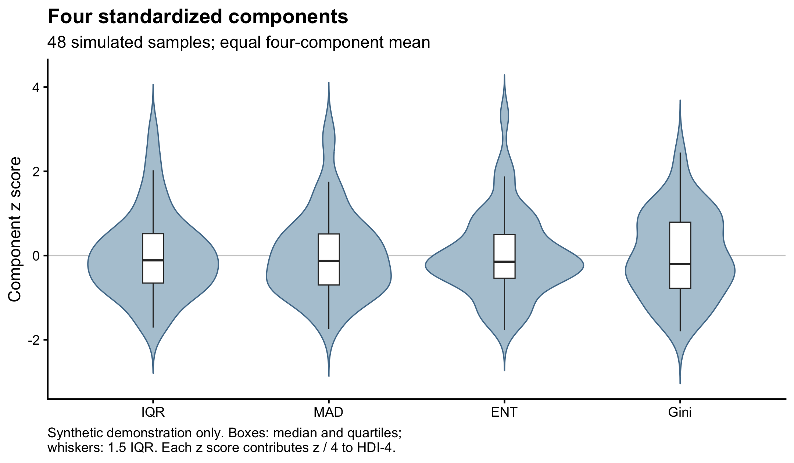

# HVG-HDI

## Overview
HVG-HDI is an R framework for selecting highly variable genes (HVGs) from 5-hydroxymethylcytosine (5hmC) signals and calculating the hydroxymethylation dispersion index (HDI), a within-sample signal-dispersion score. Distributed examples contain simulated counts only. The default HDI-4 combines four standardized components with equal weights. Optional BIM, defined as the fitted mixture-weight statistic `1-max(weights)`, supports a separate experimental HDI-5 with convergence diagnostics and explicit failure reasons.

## Installation
Use R 4.5.2 (the tested version), ggplot2, testthat, BiocManager and Bioconductor edgeR. Ubuntu source builds require development tools and `libuv1-dev`. From the software directory:

```sh
Rscript examples/install_dependencies.R
Rscript tests/run_tests.R
```

Setup fails if required packages remain missing or unloadable. No additional mixture-fitting dependency is needed.

## Quick Start
Generate fixed-seed inputs and run the default pipeline:

```sh
Rscript examples/run_demo.R results/demo
```

Repeat this exact command safely: each invocation creates a new `synthetic_*` directory under the output parent, with `inputs/` and `results/`. Routine demonstrations leave tracked figures untouched. Explicitly regenerate both tracked PNG/PDF figures with:

```sh
Rscript examples/run_demo.R results/figures --figures
```

The generator uses seed 20261020, 1,200 genes and 16 simulated participants observed at C0 (baseline), T1 (first follow-up) and T2 (second follow-up). To request optional BIM, substitute a generated run directory for RUN and choose a new result directory:

```sh
Rscript src/run_pipeline.R --counts RUN/inputs/counts.tsv \
  --meta RUN/inputs/metadata.tsv --out_dir results/optional \
  --input_scale raw_counts --profile tmm_v1 --experimental_bim true
```

Use `Rscript src/run_pipeline.R --help` for options. Input tables require `gene_id` followed by numeric sample columns, plus metadata requiring unique `sample_id` values and a `cycle` label for each sample; cycle labels can repeat. Sample sets must match exactly; missing or invalid values fail explicitly.

## Method
Raw counts undergo counts per million (CPM) filtering, trimmed mean of M-values (TMM) normalization and logCPM transformation using **all supplied samples**, including follow-up. Subsequently, only baseline observations determine the inclusive mean-quantile window and median absolute deviation (MAD) threshold for HVG selection. Follow-up counts can indirectly influence selection through upstream preprocessing.

HDI-4 averages standardized interquartile range (IQR), MAD, Shannon entropy (ENT) and Gini:

`HDI_4 = (z_IQR + z_MAD + z_ENT + z_Gini) / 4`.

Standardization uses the complete scoring cohort's component mean and sample standard deviation (SD), including follow-up. The stable version identifiers are `HDI4-v1` and `HDI5-experimental-v1`; machine-readable columns remain `HDI_4` and `HDI_5`. The [technical reference](docs/technical-reference.md) specifies definitions, reference behavior and optional fitting.

## Example Output
The default demo retains 48 samples and selects 192 HVGs. Tables include components, scores, statuses, references, parameters and provenance.



Simulated visit densities and observations; repeated visits are descriptive.



Simulated standardized components; each contributes one quarter to HDI-4.

## Limitations
Scores depend on features, preprocessing and reference composition. Optional failure preserves HDI-4 and every sample while leaving HDI-5 unavailable. Avoid preprocessing leakage in held-out analyses. These demonstrations establish software behavior without biological or clinical validation.

## License
[MIT](LICENSE), copyright lgxqzz.
